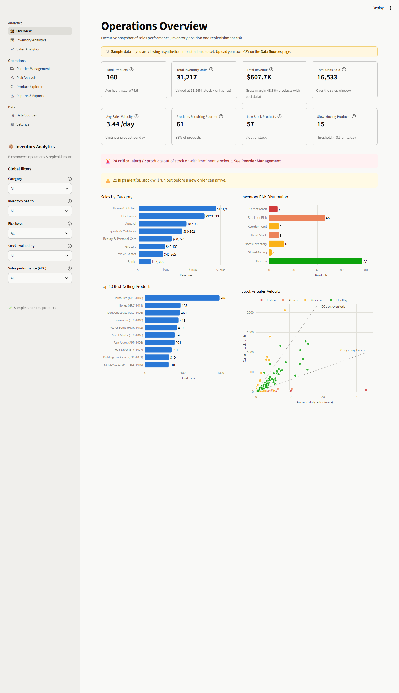
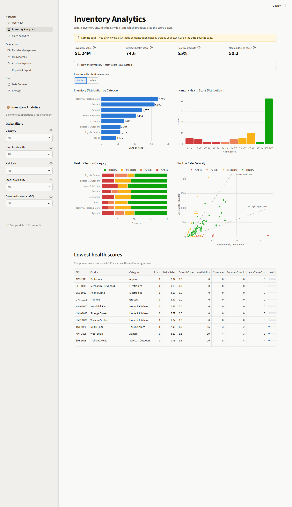
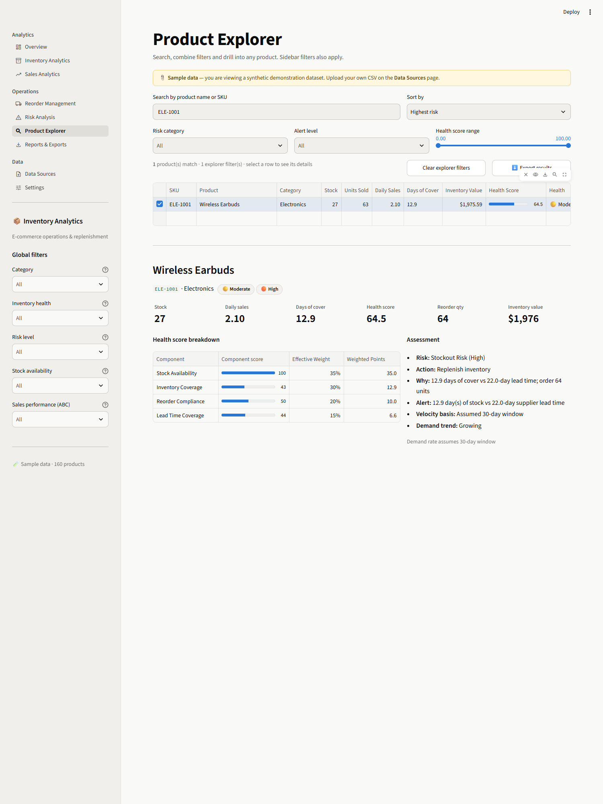
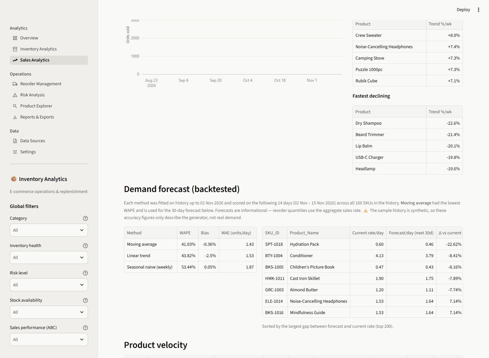

# E-commerce Operations & Inventory Analytics Dashboard

A data-driven operations dashboard for e-commerce inventory teams, built with **Python, Streamlit, Pandas, NumPy and Plotly**. It ingests a product-level inventory CSV, validates it, and turns it into the numbers an operator needs: sales velocity, an explainable **Inventory Health Score**, **dynamic reorder alerts with recommended quantities**, slow-moving and excess-stock detection, and filter-aware CSV reports.



---

## Problem statement

Retail operators balance two opposing risks:

* **Stockouts.** Lost sales, damaged search ranking and unhappy customers when fast sellers run out before a replenishment arrives.
* **Overstock.** Working capital tied up in slow or dead inventory, plus storage cost and markdown risk.

Spreadsheets show *what is in stock*. They don't show *what to do next*. This dashboard combines stock, sales and supplier lead time per SKU to answer:

* Which products will run out before a new order could arrive?
* How much should I reorder, and when will each product stock out?
* Where is capital tied up in excess or dead stock?
* How healthy is the catalogue overall, and per category?

## Key features

| Module | What it does |
|---|---|
| **Data ingestion** | CSV upload with schema and type validation, case-insensitive column matching, duplicate-SKU handling, data preview, downloadable CSV template, bundled sample data, and safe dataset replacement (an invalid upload never replaces a working dataset). **Nothing is changed or dropped silently.** Every fix and excluded row is reported with its CSV line number. |
| **Executive dashboard** | 8 dynamically calculated KPI cards and 7+ interactive Plotly charts. All of them respond to the global sidebar filters. |
| **Inventory Health Score** | A transparent 0–100 weighted score with four documented components, configurable weights, per-product breakdown, and safe handling of zero/missing values. |
| **Reorder alert engine** | Safety stock, reorder point, target stock, reorder quantity and estimated stockout date. Alerts are Critical / High / Medium / Healthy, with a written reason for each. No false alerts are raised on incomplete data. |
| **Sales velocity analytics** | Daily, weekly and monthly averages; days of inventory; category performance; ABC (Pareto) classification. Real **demand trends** come from an optional daily sales-history file. Aggregate-based figures are always labelled as such. |
| **Risk detection** | Out of Stock, Stockout Risk, Reorder Point, Dead Stock, Excess Inventory and Slow-Moving classifications, each with a recommended action and a rationale built from the product's own metrics. Tied-up working capital is quantified. |
| **Cost & margin** *(optional `Unit_Cost`)* | Gross profit, gross margin % and inventory valued at cost. Working-capital measures (excess stock, reorder value) use cost where known and record the basis per row. |
| **Statistical safety stock** *(optional)* | `z·√(L·σd² + d²·σL²)` at a configurable service level, using demand variability from the daily history and the optional `Lead_Time_Std_Days` column. Falls back to days-of-cover per product when there is not enough data, and says so. |
| **Backtested demand forecasts** *(history)* | Moving-average, linear-trend and weekly seasonal-naive forecasts, each scored on a holdout period (WAPE, bias, MAE) before the best one is shown. Accuracy is measured, never assumed. |
| **Product explorer** | Search by name/SKU combined with category, health, risk, stock, ABC, alert-level and health-range filters. Nine sort options. Select a row to see a product drill-down with its score breakdown. |
| **Reports & exports** | Complete inventory, risk, reorder and explorer-view reports as CSV. Exports contain exactly the products selected by the active filters. |
| **Settings** | Every business parameter (sales window, safety stock, review period, thresholds, weights, slow-moving cut-off, duplicate policy, as-of date) is editable, and every page recalculates on change. |

## Screenshots

| | |
|---|---|
| **Inventory analytics & health score**  | **Reorder management**  |
| **Sales analytics & demand trends**  | **Risk analysis**  |
| **Product drill-down**  | **Data sources & validation**  |
| **Backtested demand forecast**  | |

## Architecture

Business logic lives in `src/` and has **no Streamlit dependency**, so it is fully unit-testable. UI code in `components/` and `views/` only renders results.

```
ecommerce-operations-inventory-dashboard/
├── app.py                      # Streamlit entry point: navigation, sidebar, page routing
├── requirements.txt
├── pytest.ini
├── .streamlit/config.toml      # Theme
├── data/
│   ├── sample_inventory.csv              # 160 synthetic SKUs, 8 categories
│   ├── sample_sales_history.csv          # 90 days of synthetic daily sales
│   └── sample_inventory_with_errors.csv  # demonstrates validation
├── scripts/
│   ├── generate_sample_data.py           # reproducible (seeded) sample data generator
│   └── benchmark.py                      # 1k / 10k / 50k product performance benchmark
├── src/                        # ── business logic (pure pandas/numpy) ──
│   ├── config.py               # schema + AnalyticsConfig (all tunable parameters)
│   ├── data_loader.py          # robust CSV parsing (encoding, malformed rows, binary files)
│   ├── data_validator.py       # validation, typing, duplicates, rejected-row report
│   ├── sales_analytics.py      # velocity, revenue, ABC, category performance, trends
│   ├── reorder_engine.py       # safety stock, ROP, target stock, quantities, alerts
│   ├── health_score.py         # Inventory Health Score engine
│   ├── risk_analysis.py        # risk categories, tied-up capital, recommended actions
│   ├── inventory_engine.py     # pipeline orchestration + KPI summary
│   ├── forecasting.py          # baseline forecasts + holdout backtest (WAPE / bias / MAE)
│   ├── filters.py              # combined filtering & sorting
│   ├── export_manager.py       # report shaping, CSV serialisation, formula-injection guard
│   └── utils.py                # float-safe ceil/floor, vectorised string joins
├── components/                 # ── reusable UI pieces ──
│   ├── theme.py                # colour tokens, Plotly template, CSS
│   ├── charts.py               # Plotly figure builders (no calculations)
│   ├── kpi_cards.py · tables.py · alerts.py · sidebar.py
│   └── state.py                # session state, st.cache_data wrappers, page context
├── views/                      # ── one module per page ──
│   ├── overview.py · inventory.py · sales.py · reorder.py · risk.py
│   └── explorer.py · reports.py · data_sources.py · settings.py
├── tests/                      # 263 pytest tests (logic, audit regressions, headless UI)
└── docs/
    ├── technical_documentation.md
    └── screenshots/
```

**Data flow**

```
CSV bytes ──► load_csv ──► validate_inventory ──► build_inventory_metrics ──► apply_filters ──► pages / exports
              (text)       (typed + report)       velocity/margin → ABC →      (sidebar +
                                                  trends & σd → reorder →      explorer)
                                                  health → risk
```

Parsing, validation and metric computation are cached with `st.cache_data`, keyed on the file bytes and the configuration. Changing a filter never re-parses or re-scores the dataset.

### Deviations from the suggested structure (and why)

* `src/config.py` was added so that the schema and every business threshold live in one validated place instead of being hard-coded across modules.
* `views/` was added so each dashboard page is its own module, keeping `app.py` to routing only.
* `components/state.py` and `components/sidebar.py` centralise session state and caching. Pages read one immutable `PageContext`.
* The project root is the repository root rather than a nested sub-folder.

## Technology stack

Python 3.11+ (developed and tested on 3.13 only) · Streamlit · Pandas · NumPy · Plotly · PyArrow (vectorised string handling; already a Streamlit dependency) · Pytest. No other runtime dependencies.

## Installation & environment setup

```bash
# 1. Clone and enter the project
git clone https://github.com/Pavanvish10/ecommerce-operations-inventory-dashboard.git
cd ecommerce-operations-inventory-dashboard

# 2. Create and activate a virtual environment
python -m venv .venv
# Windows (PowerShell)
.venv\Scripts\Activate.ps1
# macOS / Linux
source .venv/bin/activate

# 3. Install dependencies
pip install -r requirements.txt
```

## Running the application

```bash
streamlit run app.py
```

Open http://localhost:8501. The bundled **sample dataset** loads automatically and is marked as sample data on every page. Upload your own file on **Data Sources**.

## Input data format

| Column | Required | Type | Notes |
|---|---|---|---|
| `SKU_ID` | ✅ | text | Unique key. Rows without one are excluded and reported. |
| `Product_Name` | ✅ | text | Missing → `Unnamed product (SKU)` placeholder, reported |
| `Category` | ✅ | text | Missing → `Uncategorized`, reported |
| `Current_Stock` | ✅ | number ≥ 0 | |
| `Units_Sold` | ✅ | number ≥ 0 | Units sold during the sales window |
| `Unit_Price` | ✅ | number ≥ 0 | `$1,200.50` style values are accepted |
| `Reorder_Level` | ✅ | number ≥ 0 | |
| `Supplier_Lead_Time` | ✅ | number ≥ 0 (days) | |
| `Last_Restock_Date` | optional | date | Future or unparseable dates are blanked and reported |
| `Sales_Period_Days` | optional | number > 0 | Days covered by `Units_Sold`. Overrides the assumed window. |
| `Unit_Cost` | optional | number ≥ 0 | Enables margin analysis and cost-based valuation |
| `Lead_Time_Std_Days` | optional | number ≥ 0 | Lead-time variability for the statistical safety stock |

**Optional daily sales history** (enables demand trends): `Date, SKU_ID, Units_Sold`.

Column names are matched case-insensitively, and spaces or hyphens are accepted in place of underscores. Extra columns are kept and exported but not used in calculations.

### Validation policy

* **Blocking errors:** empty or binary files, malformed CSV (rows with more fields than the header are rejected rather than letting pandas shift columns), missing required columns, no usable rows.
* **Cell-level problems** (non-numeric, negative, infinite, above 10¹², future dates) are set to missing, never guessed, and recorded in a per-row `Data_Quality_Notes` column. Affected metrics show as *Insufficient Data*.
* **Numbers:** a comma is accepted only as a thousands separator (`1,234.50`). Ambiguous values such as `12,50` (possibly a decimal comma) are rejected with a hint rather than silently read as 1250.
* **Dates:** timezone-aware timestamps are converted to UTC. Dates like `03/04/2026`, where day and month are ambiguous, are read month-first and flagged.
* **SKUs differing only by letter case** (`abc-1` / `ABC-1`) are kept separate and flagged for review.
* **Duplicates:** exact duplicate rows are collapsed. Conflicting rows for the same SKU keep the first (or last, configurable) occurrence, and the others appear in the **excluded rows** report with the reason.
* Every input row ends up either accepted or in the excluded-rows report.

## Sample dataset

`data/sample_inventory.csv` is **synthetic** data generated by `scripts/generate_sample_data.py` with a fixed random seed (randomness is used only to create demo data, never in calculations). It contains 160 SKUs across 8 categories, deliberately mixing healthy, low, critical, out-of-stock, excess and dead-stock scenarios. `Units_Sold` equals the last 30 days of `sample_sales_history.csv`, so the default 30-day window is consistent with the history. `sample_inventory_with_errors.csv` is a 9-row file showing every validation rule.

## Business logic

Notation per product: `S` stock, `U` units sold, `W` sales window (days), `d = U / W` average daily sales, `L` lead time, `RL` reorder level. All parameters in *italics* are configurable on the Settings page (defaults in brackets).

### Sales velocity

```
d   = U / W                 W = Sales_Period_Days if supplied, else the assumed window [30]
weekly = 7·d   monthly = 30·d
DOI = S / d                 (0 if S = 0; ∞ if d = 0 and S > 0; unknown if inputs missing)
Revenue = U × Unit_Price    Inventory value = S × Unit_Price   (retail value)
Unit value = Unit_Cost if supplied, else Unit_Price               (used for working capital)
Gross profit = U × (Unit_Price − Unit_Cost)    Gross margin = gross profit ÷ revenue
```

Before any integer rounding (`ceil` for quantities, `floor` for excess units and stockout days), values are rounded to 9 decimals. This absorbs binary floating-point noise: for example, 23 units of stock selling 23/30 per day is exactly 30 days of cover, not 29.999999999999996, which would otherwise trigger a false lead-time alert.

The `Velocity_Basis` column records whether each row used a reported period or the assumed window. The UI states clearly that these are average rates, **not observed daily trends**.

**ABC classification:** products ranked by revenue. Those making up the first 80 % of revenue are **A**, the next 15 % are **B**, the rest are **C**.

**Demand trend** (only with a daily history): a least-squares slope of daily units over the history calendar (missing days = 0 sales), expressed as `slope × 7 / mean daily demand`. More than +*5* %/week is Growing, less than −*5* %/week is Declining, and anything in between is Stable. Fewer than *14* days of history or zero demand gives *Insufficient History*.

### Inventory Health Score (0–100)

Four components, each in [0, 1]:

| Component | Weight | Formula | Measures |
|---|---|---|---|
| Stock availability **A** | *35 %* | `0` if S = 0 · `1` if SS = 0 · else `min(1, S / SS)`, where SS is the active safety stock (below) | Is there at least a safety buffer on hand? |
| Inventory coverage **C** | *30 %* | `DOI/T` if DOI ≤ T · `1` if T < DOI ≤ O · `max(0, 1 − (DOI−O)/O)` if DOI > O, with T = *30*, O = *120* days | Penalises under- **and** over-stocking. Dead stock (DOI = ∞) scores 0. |
| Reorder compliance **R** | *20 %* | `min(1, S / (RL × (1 + B)))`, B = *20 %* · if RL = 0: 1 if S > 0 else 0 | Respect for the operator's own reorder policy |
| Lead-time coverage **LT** | *15 %* | `0` if S = 0 · `1` if d = 0 · else `min(1, DOI / (L + SS/d))` | Will stock last until an order placed today arrives? |

```
Health Score = 100 × Σ wᵢ·cᵢ / Σ wᵢ      (over the components that can be computed)
```

| Score | Class |
|---|---|
| 80–100 | 🟢 Healthy |
| 60–79.9 | 🟡 Moderate |
| 40–59.9 | 🟠 At Risk |
| 0–39.9 | 🔴 Critical |

**Edge cases.** Zero stock scores 0. Zero sales with stock scores A = LT = 1 and C = 0 (70 with default weights, then flagged as Dead Stock by the risk engine). Missing stock or sales gives *Insufficient Data* (no score). A missing `Reorder_Level` or `Supplier_Lead_Time` drops that component, re-normalises the remaining weights, and labels the row *Partial score*. All divisions are guarded, so no input can produce NaN/∞ scores or values outside 0–100. This is property-tested over a grid of extreme inputs.

**Worked example** (from the tests): S = 27, U = 63 over 30 days → d = 2.1, RL = 45, L = 22.
A = min(1, 27/14.7) = 1 · C = 12.86/30 = 0.429 · R = 27/54 = 0.5 · LT = 12.86/29 = 0.443
→ 100 × (0.35·1 + 0.30·0.429 + 0.20·0.5 + 0.15·0.443) = **64.5 (Moderate)**.

### Reorder engine

```
Safety stock        SS  = d × safety_stock_days                [7]   (default "days of cover")
                    SS  = z × √(L·σd² + d²·σL²)                       (statistical, optional)
Reorder point       ROP = d × L + SS
Threshold           T   = max(RL, ROP)   (or RL only / ROP only — configurable)
Target stock        TS  = max(d × (L + R) + SS,  T + d × R)   R = review period [14]
Reorder quantity    Q   = ceil(max(0, TS − S))                  when a reorder is needed
Stockout date           = as-of date + floor(S / d)             (constant-demand assumption;
                                                                  not projected beyond 10 years)
```

**Statistical safety stock** (Settings → *Safety stock method*): `z` is the standard-normal quantile of the service level [95 % → 1.645], `σd` is the sample standard deviation of daily units over the history calendar (missing days count as 0), and `σL` comes from `Lead_Time_Std_Days` (0 if absent). This is the standard formula for independent demand and lead-time variability. Products with fewer than *14* days of history or no lead time fall back to days-of-cover, and the `Safety_Stock_Method` column records which method each product used. `d` stays the aggregate sales rate, so every quantity remains traceable to the inventory file.

Taking the larger of the two target terms guarantees an order always lifts stock above the threshold that triggered it, even when the dataset's `Reorder_Level` exceeds the demand-based reorder point.

| Alert | Rule (evaluated in order) |
|---|---|
| ⚪ Insufficient Data | stock or sales unknown. **No alert is raised.** |
| 🔴 Critical | d > 0 and (S = 0 or DOI ≤ *3* days) |
| 🟠 High | d > 0 and DOI < L (stock runs out before an order placed now can arrive) |
| 🟡 Medium | S ≤ T × (1 + B), or out of stock with no recorded demand |
| 🟢 Healthy | otherwise |

A reorder is recommended for Critical and High alerts and for any product at or below T. When demand is zero, the quantity only restores the reorder level and a note says so. When lead time is missing, lead-time risk is not evaluated and a note says so. When the demand rate relies on the assumed window, that is noted too.

Worked example: d = 2.1, L = 22, RL = 45, S = 27 → SS = 14.7, ROP = 60.9, T = 60.9, TS = 90.3 → **Q = 64 units**, alert **High** (12.9 days of cover vs 22-day lead time).

### Risk classification & recommended actions

| Category (first match wins) | Rule | Risk level | Action |
|---|---|---|---|
| Out of Stock | S = 0 | Critical (Medium if d = 0) | Replenish (urgent) / Investigate demand |
| Stockout Risk | Critical or High alert | Critical / High | Replenish (urgent) / Replenish |
| Reorder Point | at/below threshold T (not yet a stockout risk) | Medium | Replenish inventory |
| Dead Stock | U = 0 and S > 0 | High | Investigate demand |
| Excess Inventory | DOI > *120* days | Medium | Reduce purchasing (Review pricing if also slow-moving) |
| Slow-Moving | d < *0.5*/day | Low | Monitor inventory |
| Healthy | — | Low | Monitor inventory |

**Tied-up working capital** = `floor(max(0, S − d × 120)) × Unit value`, i.e. the value of stock beyond the overstock horizon (all stock, for products with no sales), at cost where `Unit_Cost` is known.

*Naming note:* the risk category is called **Reorder Point** rather than "Low Stock" because the *Stock availability* filter's "Low Stock" means `S ≤ Reorder_Level` (the dataset value), while this category uses the effective threshold T, which can be the higher, demand-based reorder point.

### Demand forecasting (with a daily history)

Three transparent baselines are fitted per SKU on the last *28* days: **moving average**, **linear trend** (clipped at 0) and **seasonal naive** (repeats the last week). Each is refitted on history that excludes the last *14* days, then scored on those held-out days:

```
WAPE = Σ|actual − forecast| / Σ actual      Bias = (Σ forecast − Σ actual) / Σ actual      MAE per SKU-day
```

The method with the lowest WAPE produces the 30-day forecast shown on the Sales page. On the synthetic sample history the scores are moving average **41.0 %**, linear trend 43.8 % and seasonal naive 53.4 % WAPE. Those numbers describe the data generator, not real demand. Forecasts are informational and do not change reorder quantities. If the history is too short, no forecast is shown at all.

## Performance

Measured with `python scripts/benchmark.py --repeat 3 [--history-days 90]` on an Intel Core i5-1235U (12 logical CPUs, 16 GB RAM), Windows 11, Python 3.13.2, pandas 3.1.1. Times are seconds, best of 3, single process, warm.

| Products | CSV size | Load | Validate | Metrics | Filter | Sort | Full export | Peak RAM |
|---:|---:|---:|---:|---:|---:|---:|---:|---:|
| 1,000 | 0.07 MB | 0.005 | 0.05 | 0.11 | 0.002 | 0.002 | 0.09 | — |
| 10,000 | 0.75 MB | 0.07 | 0.12 | 0.25 | 0.007 | 0.011 | 0.38 | — |
| 50,000 | 3.8 MB | 0.20 | 0.26 | **0.60** | 0.018 | 0.05 | 1.46 | 290 MB |

With a 90-day daily history (67k / 671k / 3.3M rows; 1.7 / 17 / 87 MB):

| Products | History load + validate | Metrics incl. trends | Peak RAM |
|---:|---:|---:|---:|
| 1,000 | 0.12 | 0.07 | — |
| 10,000 | 1.16 | 0.36 | — |
| 50,000 | 6.0 | 1.69 | 890 MB |

**Optimisations made during the audit** (50k products, before → after): metrics 2.75 s → 0.60 s (row-wise `apply` string joins replaced with vectorised joins; rationale text formatted only for the rows each rule applies to), history validation 14.4 s → 6.0 s (vectorised numeric fast path; pyarrow-backed strings). In the app, parsing and scoring are cached, so changing a filter costs only the filter step (~20 ms at 50k).

**Limits:** uploads are capped at **100 MB** (`.streamlit/config.toml` and `src/data_loader.py`), which corresponds to about 1 GB peak RAM. The full-report export at 50k products is dominated by pandas' CSV writer (~70 columns). Memory was measured as process peak working set and was not profiled per stage. Timings vary by about ±30 % between runs on this laptop.

## Security

| Area | Finding | Status |
|---|---|---|
| CSV upload | Parsed in memory only. No temp files are written, uploaded file names are never used as paths, size is capped, binary/malformed files are rejected, and every value is validated. | ✅ |
| XSS | Uploaded text was interpolated into raw HTML in the product drill-down. | **Fixed:** HTML-escaped. Browser-tested with an `` payload: rendered as text, no element injected, no script ran. |
| Markdown injection | File names and CSV headers were rendered as Markdown (links, formatting). | **Fixed:** escaped. |
| CSV / formula injection | Exported cells beginning with `= + - @` would execute in Excel. | **Fixed:** prefixed with `'` (OWASP). Plain negative numbers are left intact. |
| Path traversal | No user-controlled paths. Download names are generated server-side. | ✅ none |
| Secrets | None in the repo. `.env` and `secrets.toml` are git-ignored. | ✅ |
| Dependencies | `pip-audit` over all 40 pinned packages in the environment. | ✅ no known vulnerabilities (17 Nov 2026) |
| Resource use | `st.cache_data` is shared by all sessions in the process. | Bounded: `max_entries` plus a 1-hour TTL. Uploaded data is cached only under its content hash, so another session cannot retrieve it without already having the identical file. |

## Testing

```bash
pytest            # runs all 263 tests (~35 s)
pytest -q tests/test_health_score.py    # a single module
```

| Test module | Covers |
|---|---|
| `test_data_validation.py` | CSV upload (path, bytes, file-like, BOM, cp1252), invalid/malformed/binary files, missing columns, missing values, invalid and negative numbers, currency parsing, dates, duplicate SKUs (first/last), "nothing discarded silently" |
| `test_health_score.py` | Hand-calculated scores, zero stock, zero sales, missing inputs, re-weighting, class boundaries (79.9 / 80.0 …), coverage piecewise function, bounds over an extreme-value grid, custom weights, determinism |
| `test_reorder_engine.py` | Hand-calculated quantities, critical/high/medium/healthy boundaries, zero-sales scenarios (no false alerts), missing lead time, threshold modes, safety-stock sensitivity, reported sales period, urgency ordering |
| `test_sales_analytics.py` | Velocity, days of inventory edge cases, ABC boundaries, category aggregation, deterministic ties, slow movers, demand trends, partial-week handling |
| `test_inventory_engine.py` | Full pipeline determinism, no input mutation, KPI correctness against manual sums, risk categories/levels/actions, slow-moving boundary, tied-up capital, config validation |
| `test_filters.py` | Search (case, whitespace, regex-literal), every filter, combined AND logic, health-range NaN handling, all sort options, NaN-last ordering |
| `test_export.py` | Filtered exports contain exactly the filtered SKUs, risk/reorder report contents and order, CSV round-trip types, ISO dates, explicit "No demand" instead of `inf`, empty exports |
| `test_app_smoke.py` | Headless Streamlit `AppTest`: app start-up, every page renders without exceptions, sidebar filter → KPI update, explorer search, settings recalculation, statistical safety stock end to end, backtested forecast shown, invalid settings rejected |
| `test_audit_regressions.py` | One test per audit defect: decimal commas, magnitude cap, timezone dates, ambiguous dates, SKU case, float noise, stockout-date overflow, formula injection, XSS, Markdown injection, label consistency, upload cap, vectorised joins. Also a **property test comparing the engine with an exact rational-arithmetic reference over 630 input combinations**, and a 20k-row scale guard. |
| `test_advanced_analytics.py` | Margin and cost valuation (with fallbacks), the statistical safety-stock formula and its fallbacks, service-level monotonicity, forecasting (each method wins on its own pattern, holdout-only scoring, insufficient-history handling) |

## Regenerating the sample data

```bash
python scripts/generate_sample_data.py
```

## Known limitations

* Velocity from an aggregate `Units_Sold` figure is an average rate. Forecasts are informational: reorder quantities still use the aggregate rate.
* The forecasting methods are simple baselines (no ARIMA or gradient boosting). The statistical safety stock assumes normally distributed, independent demand.
* **Multi-warehouse inventory is not supported.** `SKU_ID` is the unique key throughout, so a location dimension would change the key to `(SKU_ID, Location)` in validation, the merge with history, the reorder plan and filters, with roll-ups per SKU. This was evaluated but not implemented, because it would touch every module and could not be done reliably within this audit.
* Sessions are in memory only: settings and uploaded data are lost on a full browser reload, and settings are not persisted.
* Timezone-aware dates are converted to UTC, so a local late-evening timestamp can shift by a day.
* Only Python 3.13 was tested. Python 3.11/3.12 should work but were not verified.

## Future improvements

* Optionally drive reorder quantities from the best backtested forecast (with the accuracy gate already in place).
* Stronger forecasters (exponential smoothing, intermittent-demand methods such as Croston for slow movers) evaluated against the same backtest.
* Multi-warehouse inventory (see limitations) and supplier-level views (on-time rate, MOQ, case packs).
* GMROI and inventory-turnover KPIs now that cost data is supported.
* Persisted settings and scheduled e-mail reports; database or S3 ingestion.
