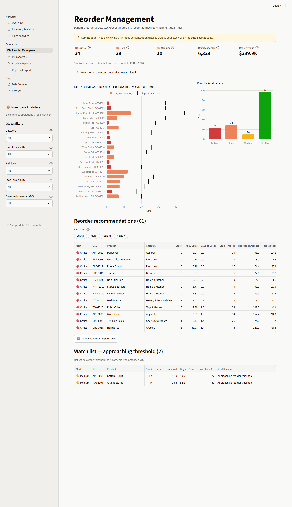
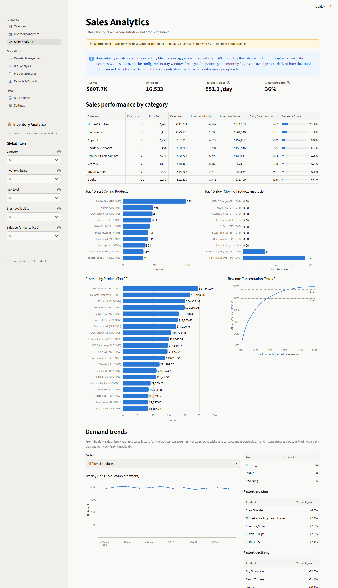
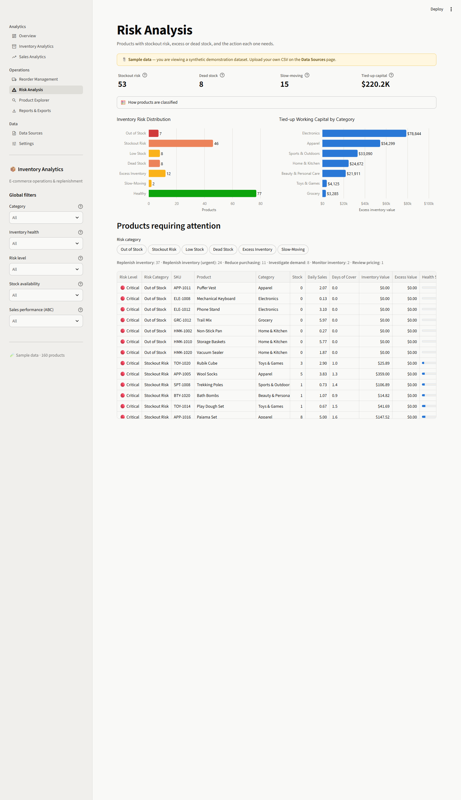
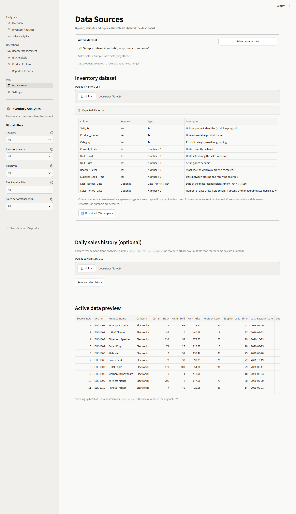

# E-commerce Operations & Inventory Analytics Dashboard

A data-driven operations dashboard for e-commerce inventory teams, built with **Python, Streamlit, Pandas, NumPy and Plotly**. It ingests a product-level inventory CSV, validates it, and turns it into the numbers an operator needs: sales velocity, an explainable **Inventory Health Score**, **dynamic reorder alerts with recommended quantities**, slow-moving and excess-stock detection, and filter-aware CSV reports.


---

## Problem statement

Retail operators balance two opposing risks:

* **Stockouts.** Lost sales, damaged search ranking and unhappy customers when fast sellers run out before a replenishment arrives.
* **Overstock.** Working capital tied up in slow or dead inventory, plus storage cost and markdown risk.

Spreadsheets show *what is in stock*. They don't show *what to do next*. This dashboard combines stock, sales and supplier lead time per SKU to answer:

* Which products will run out before a new order could arrive?
* How much should I reorder, and when will each product stock out?
* Where is capital tied up in excess or dead stock?
* How healthy is the catalogue overall, and per category?

## Key features

| Module | What it does |
|---|---|
| **Data ingestion** | CSV upload with schema and type validation, case-insensitive column matching, duplicate-SKU handling, data preview, downloadable CSV template, bundled sample data, and safe dataset replacement (an invalid upload never replaces a working dataset). **Nothing is changed or dropped silently.** Every fix and excluded row is reported with its CSV line number. |
| **Executive dashboard** | 8 dynamically calculated KPI cards and 7+ interactive Plotly charts. All of them respond to the global sidebar filters. |
| **Inventory Health Score** | A transparent 0–100 weighted score with four documented components, configurable weights, per-product breakdown, and safe handling of zero/missing values. |
| **Reorder alert engine** | Safety stock, reorder point, target stock, reorder quantity and estimated stockout date. Alerts are Critical / High / Medium / Healthy, with a written reason for each. No false alerts are raised on incomplete data. |
| **Sales velocity analytics** | Daily, weekly and monthly averages; days of inventory; category performance; ABC (Pareto) classification. Real **demand trends** come from an optional daily sales-history file. Aggregate-based figures are always labelled as such. |
| **Risk detection** | Out of Stock, Stockout Risk, Low Stock, Dead Stock, Excess Inventory and Slow-Moving classifications, each with a recommended action and a rationale built from the product's own metrics. Tied-up working capital is quantified. |
| **Product explorer** | Search by name/SKU combined with category, health, risk, stock, ABC, alert-level and health-range filters. Nine sort options. Select a row to see a product drill-down with its score breakdown. |
| **Reports & exports** | Complete inventory, risk, reorder and explorer-view reports as CSV. Exports contain exactly the products selected by the active filters. |
| **Settings** | Every business parameter (sales window, safety stock, review period, thresholds, weights, slow-moving cut-off, duplicate policy, as-of date) is editable, and every page recalculates on change. |

## Screenshots

| | |
|---|---|
| **Inventory analytics & health score**  | **Reorder management**  |
| **Sales analytics & demand trends**  | **Risk analysis**  |
| **Product drill-down**  | **Data sources & validation**  |

## Architecture

Business logic lives in `src/` and has **no Streamlit dependency**, so it is fully unit-testable. UI code in `components/` and `views/` only renders results.

```
cartify/
├── app.py                      # Streamlit entry point: navigation, sidebar, page routing
├── requirements.txt
├── pytest.ini
├── .streamlit/config.toml      # Theme
├── data/
│   ├── sample_inventory.csv              # 160 synthetic SKUs, 8 categories
│   ├── sample_sales_history.csv          # 90 days of synthetic daily sales
│   └── sample_inventory_with_errors.csv  # demonstrates validation
├── scripts/
│   └── generate_sample_data.py           # reproducible (seeded) sample data generator
├── src/                        # ── business logic (pure pandas/numpy) ──
│   ├── config.py               # schema + AnalyticsConfig (all tunable parameters)
│   ├── data_loader.py          # robust CSV parsing (encoding, malformed rows, binary files)
│   ├── data_validator.py       # validation, typing, duplicates, rejected-row report
│   ├── sales_analytics.py      # velocity, revenue, ABC, category performance, trends
│   ├── reorder_engine.py       # safety stock, ROP, target stock, quantities, alerts
│   ├── health_score.py         # Inventory Health Score engine
│   ├── risk_analysis.py        # risk categories, tied-up capital, recommended actions
│   ├── inventory_engine.py     # pipeline orchestration + KPI summary
│   ├── filters.py              # combined filtering & sorting
│   └── export_manager.py       # report shaping & CSV serialisation
├── components/                 # ── reusable UI pieces ──
│   ├── theme.py                # colour tokens, Plotly template, CSS
│   ├── charts.py               # Plotly figure builders (no calculations)
│   ├── kpi_cards.py · tables.py · alerts.py · sidebar.py
│   └── state.py                # session state, st.cache_data wrappers, page context
├── views/                      # ── one module per page ──
│   ├── overview.py · inventory.py · sales.py · reorder.py · risk.py
│   └── explorer.py · reports.py · data_sources.py · settings.py
├── tests/                      # 212 pytest tests (logic + headless UI)
└── docs/
    ├── technical_documentation.md
    └── screenshots/
```

**Data flow**

```
CSV bytes ──► load_csv ──► validate_inventory ──► build_inventory_metrics ──► apply_filters ──► pages / exports
              (text)       (typed + report)       velocity → ABC → reorder     (sidebar +
                                                  → health → risk → trends     explorer)
```

Parsing, validation and metric computation are cached with `st.cache_data`, keyed on the file bytes and the configuration. Changing a filter never re-parses or re-scores the dataset.

### Deviations from the suggested structure (and why)

* `src/config.py` was added so that the schema and every business threshold live in one validated place instead of being hard-coded across modules.
* `views/` was added so each dashboard page is its own module, keeping `app.py` to routing only.
* `components/state.py` and `components/sidebar.py` centralise session state and caching. Pages read one immutable `PageContext`.
* The project root is the repository root (`cartify/`) rather than a nested `ecommerce-inventory-dashboard/` folder.

## Technology stack

Python 3.11+ (developed on 3.13) · Streamlit · Pandas · NumPy · Plotly · Pytest. No other runtime dependencies.

## Installation & environment setup

```bash
# 1. Clone and enter the project
git clone <your-repo-url> cartify
cd cartify

# 2. Create and activate a virtual environment
python -m venv .venv
# Windows (PowerShell)
.venv\Scripts\Activate.ps1
# macOS / Linux
source .venv/bin/activate

# 3. Install dependencies
pip install -r requirements.txt
```

## Running the application

```bash
streamlit run app.py
```

Open http://localhost:8501. The bundled **sample dataset** loads automatically and is marked as sample data on every page. Upload your own file on **Data Sources**.

## Input data format

| Column | Required | Type | Notes |
|---|---|---|---|
| `SKU_ID` | ✅ | text | Unique key. Rows without one are excluded and reported. |
| `Product_Name` | ✅ | text | Missing → `Unnamed product (SKU)` placeholder, reported |
| `Category` | ✅ | text | Missing → `Uncategorized`, reported |
| `Current_Stock` | ✅ | number ≥ 0 | |
| `Units_Sold` | ✅ | number ≥ 0 | Units sold during the sales window |
| `Unit_Price` | ✅ | number ≥ 0 | `$1,200.50` style values are accepted |
| `Reorder_Level` | ✅ | number ≥ 0 | |
| `Supplier_Lead_Time` | ✅ | number ≥ 0 (days) | |
| `Last_Restock_Date` | optional | date | Future or unparseable dates are blanked and reported |
| `Sales_Period_Days` | optional | number > 0 | Days covered by `Units_Sold`. Overrides the assumed window. |

**Optional daily sales history** (enables demand trends): `Date, SKU_ID, Units_Sold`.

Column names are matched case-insensitively, and spaces or hyphens are accepted in place of underscores. Extra columns are kept and exported but not used in calculations.

### Validation policy

* **Blocking errors:** empty or binary files, malformed CSV (rows with more fields than the header are rejected rather than letting pandas shift columns), missing required columns, no usable rows.
* **Cell-level problems** (non-numeric, negative, infinite, future dates) are set to missing, never guessed, and recorded in a per-row `Data_Quality_Notes` column. Affected metrics show as *Insufficient Data*.
* **Duplicates:** exact duplicate rows are collapsed. Conflicting rows for the same SKU keep the first (or last, configurable) occurrence, and the others appear in the **excluded rows** report with the reason.
* Every input row ends up either accepted or in the excluded-rows report.

## Sample dataset

`data/sample_inventory.csv` is **synthetic** data generated by `scripts/generate_sample_data.py` with a fixed random seed (randomness is used only to create demo data, never in calculations). It contains 160 SKUs across 8 categories, deliberately mixing healthy, low, critical, out-of-stock, excess and dead-stock scenarios. `Units_Sold` equals the last 30 days of `sample_sales_history.csv`, so the default 30-day window is consistent with the history. `sample_inventory_with_errors.csv` is a 9-row file showing every validation rule.

## Business logic

Notation per product: `S` stock, `U` units sold, `W` sales window (days), `d = U / W` average daily sales, `L` lead time, `RL` reorder level. All parameters in *italics* are configurable on the Settings page (defaults in brackets).

### Sales velocity

```
d   = U / W                 W = Sales_Period_Days if supplied, else the assumed window [30]
weekly = 7·d   monthly = 30·d
DOI = S / d                 (0 if S = 0; ∞ if d = 0 and S > 0; unknown if inputs missing)
Revenue = U × Unit_Price    Inventory value = S × Unit_Price
```

The `Velocity_Basis` column records whether each row used a reported period or the assumed window. The UI states clearly that these are average rates, **not observed daily trends**.

**ABC classification:** products ranked by revenue. Those making up the first 80 % of revenue are **A**, the next 15 % are **B**, the rest are **C**.

**Demand trend** (only with a daily history): a least-squares slope of daily units over the history calendar (missing days = 0 sales), expressed as `slope × 7 / mean daily demand`. More than +*5* %/week is Growing, less than −*5* %/week is Declining, and anything in between is Stable. Fewer than *14* days of history or zero demand gives *Insufficient History*.

### Inventory Health Score (0–100)

Four components, each in [0, 1]:

| Component | Weight | Formula | Measures |
|---|---|---|---|
| Stock availability **A** | *35 %* | `0` if S = 0 · `1` if SS = 0 · else `min(1, S / SS)` with `SS = d × safety days [7]` | Is there at least a safety buffer on hand? |
| Inventory coverage **C** | *30 %* | `DOI/T` if DOI ≤ T · `1` if T < DOI ≤ O · `max(0, 1 − (DOI−O)/O)` if DOI > O, with T = *30*, O = *120* days | Penalises under- **and** over-stocking. Dead stock (DOI = ∞) scores 0. |
| Reorder compliance **R** | *20 %* | `min(1, S / (RL × (1 + B)))`, B = *20 %* · if RL = 0: 1 if S > 0 else 0 | Respect for the operator's own reorder policy |
| Lead-time coverage **LT** | *15 %* | `0` if S = 0 · `1` if d = 0 · else `min(1, DOI / (L + safety days))` | Will stock last until an order placed today arrives? |

```
Health Score = 100 × Σ wᵢ·cᵢ / Σ wᵢ      (over the components that can be computed)
```

| Score | Class |
|---|---|
| 80–100 | 🟢 Healthy |
| 60–79.9 | 🟡 Moderate |
| 40–59.9 | 🟠 At Risk |
| 0–39.9 | 🔴 Critical |

**Edge cases.** Zero stock scores 0. Zero sales with stock scores A = LT = 1 and C = 0 (70 with default weights, then flagged as Dead Stock by the risk engine). Missing stock or sales gives *Insufficient Data* (no score). A missing `Reorder_Level` or `Supplier_Lead_Time` drops that component, re-normalises the remaining weights, and labels the row *Partial score*. All divisions are guarded, so no input can produce NaN/∞ scores or values outside 0–100. This is property-tested over a grid of extreme inputs.

**Worked example** (from the tests): S = 27, U = 63 over 30 days → d = 2.1, RL = 45, L = 22.
A = min(1, 27/14.7) = 1 · C = 12.86/30 = 0.429 · R = 27/54 = 0.5 · LT = 12.86/29 = 0.443
→ 100 × (0.35·1 + 0.30·0.429 + 0.20·0.5 + 0.15·0.443) = **64.5 (Moderate)**.

### Reorder engine

```
Safety stock        SS  = d × safety_stock_days                [7]
Reorder point       ROP = d × L + SS
Threshold           T   = max(RL, ROP)   (or RL only / ROP only — configurable)
Target stock        TS  = max(d × (L + R) + SS,  T + d × R)   R = review period [14]
Reorder quantity    Q   = ceil(max(0, TS − S))                  when a reorder is needed
Stockout date           = as-of date + floor(S / d)             (constant-demand assumption)
```

Taking the larger of the two target terms guarantees an order always lifts stock above the threshold that triggered it, even when the dataset's `Reorder_Level` exceeds the demand-based reorder point.

| Alert | Rule (evaluated in order) |
|---|---|
| ⚪ Insufficient Data | stock or sales unknown. **No alert is raised.** |
| 🔴 Critical | d > 0 and (S = 0 or DOI ≤ *3* days) |
| 🟠 High | d > 0 and DOI < L (stock runs out before an order placed now can arrive) |
| 🟡 Medium | S ≤ T × (1 + B), or out of stock with no recorded demand |
| 🟢 Healthy | otherwise |

A reorder is recommended for Critical and High alerts and for any product at or below T. When demand is zero, the quantity only restores the reorder level and a note says so. When lead time is missing, lead-time risk is not evaluated and a note says so. When the demand rate relies on the assumed window, that is noted too.

Worked example: d = 2.1, L = 22, RL = 45, S = 27 → SS = 14.7, ROP = 60.9, T = 60.9, TS = 90.3 → **Q = 64 units**, alert **High** (12.9 days of cover vs 22-day lead time).

### Risk classification & recommended actions

| Category (first match wins) | Rule | Risk level | Action |
|---|---|---|---|
| Out of Stock | S = 0 | Critical (Medium if d = 0) | Replenish (urgent) / Investigate demand |
| Stockout Risk | Critical or High alert | Critical / High | Replenish (urgent) / Replenish |
| Low Stock | at/below threshold T | Medium | Replenish inventory |
| Dead Stock | U = 0 and S > 0 | High | Investigate demand |
| Excess Inventory | DOI > *120* days | Medium | Reduce purchasing (Review pricing if also slow-moving) |
| Slow-Moving | d < *0.5*/day | Low | Monitor inventory |
| Healthy | — | Low | Monitor inventory |

**Tied-up working capital** = `max(0, S − d × 120) × Unit_Price`, i.e. the value of stock beyond the overstock horizon (all stock, for products with no sales).

## Testing

```bash
pytest            # runs all 212 tests (~16 s)
pytest -q tests/test_health_score.py    # a single module
```

| Test module | Covers |
|---|---|
| `test_data_validation.py` | CSV upload (path, bytes, file-like, BOM, cp1252), invalid/malformed/binary files, missing columns, missing values, invalid and negative numbers, currency parsing, dates, duplicate SKUs (first/last), "nothing discarded silently" |
| `test_health_score.py` | Hand-calculated scores, zero stock, zero sales, missing inputs, re-weighting, class boundaries (79.9 / 80.0 …), coverage piecewise function, bounds over an extreme-value grid, custom weights, determinism |
| `test_reorder_engine.py` | Hand-calculated quantities, critical/high/medium/healthy boundaries, zero-sales scenarios (no false alerts), missing lead time, threshold modes, safety-stock sensitivity, reported sales period, urgency ordering |
| `test_sales_analytics.py` | Velocity, days of inventory edge cases, ABC boundaries, category aggregation, deterministic ties, slow movers, demand trends, partial-week handling |
| `test_inventory_engine.py` | Full pipeline determinism, no input mutation, KPI correctness against manual sums, risk categories/levels/actions, slow-moving boundary, tied-up capital, config validation |
| `test_filters.py` | Search (case, whitespace, regex-literal), every filter, combined AND logic, health-range NaN handling, all sort options, NaN-last ordering |
| `test_export.py` | Filtered exports contain exactly the filtered SKUs, risk/reorder report contents and order, CSV round-trip types, ISO dates, explicit "No demand" instead of `inf`, empty exports |
| `test_app_smoke.py` | Headless Streamlit `AppTest`: app start-up, every page renders without exceptions, sidebar filter → KPI update, explorer search, settings recalculation, invalid settings rejected |

## Regenerating the sample data

```bash
python scripts/generate_sample_data.py
```

## Known limitations

* Velocity from an aggregate `Units_Sold` figure is an average rate. Seasonality and promotions only show up when a daily history is uploaded, and even then reorder quantities use the aggregate rate.
* Safety stock is days-of-demand based, not a statistical (σ·z·√L) model, because demand variance is unavailable without history.
* `Reorder_Value` uses selling price, since purchase cost is not part of the schema.
* Settings live in the browser session and are not persisted between sessions.

## Future improvements

* Statistical safety stock and service-level targets when daily history is present.
* Forecast-driven reorder quantities (e.g. exponential smoothing) and seasonality detection.
* Purchase cost and margin fields for true working-capital and GMROI analysis.
* Multi-warehouse inventory and supplier-level views (on-time rate, MOQ, case packs).
* Persisted settings and scheduled e-mail reports; database or S3 ingestion.
